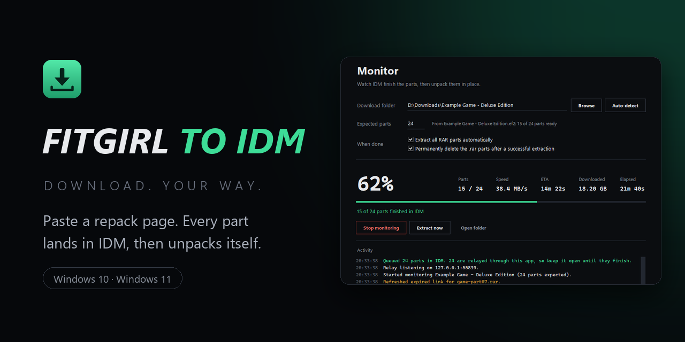
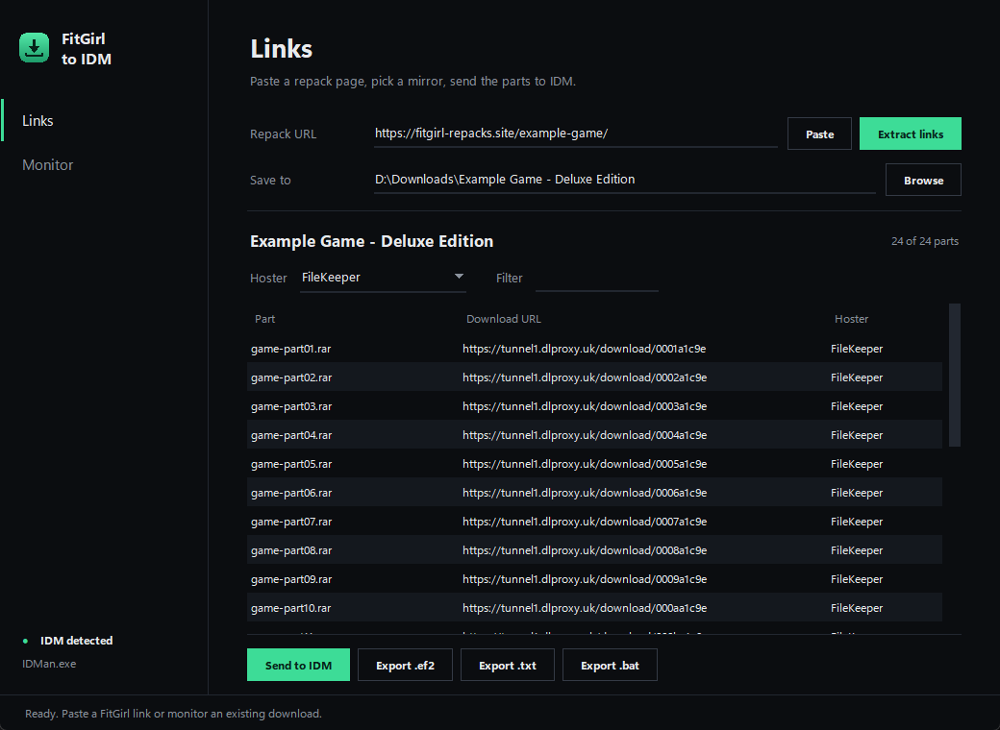
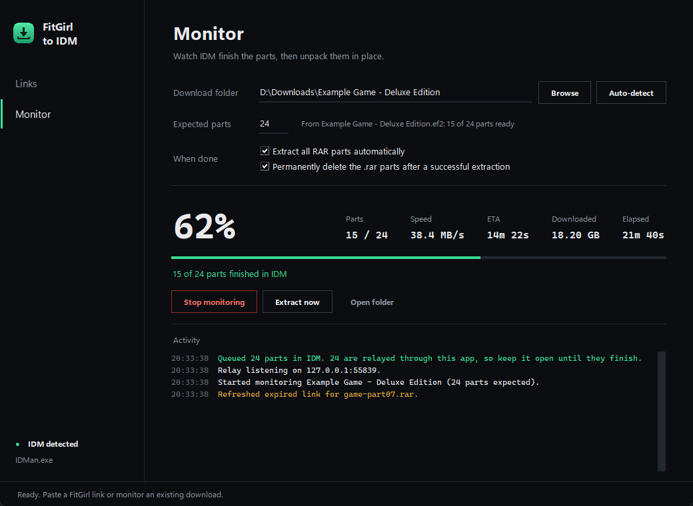

# FITGIRL TO IDM

<p align="center">
  
</p>

<p align="center"><strong>DOWNLOAD. YOUR WAY.</strong></p>

Paste a FitGirl Repacks page and every part goes straight into Internet Download Manager. No browser, no countdowns, no import step. The app then watches IDM finish the parts and unpacks the repack for you.

Direct links are resolved by the app itself. FileKeeper parts, which IDM alone gets a 403 on, are served to IDM through a small relay on `127.0.0.1` that adds the browser headers the host expects.

## Features

- **One-click hand-off** - *Send to IDM* queues every part and starts the queue
- **Mirror picker** - FileKeeper, DataNodes, Pixeldrain, FuckingFast, MediaFire and more, with a live filter
- **Relay for 403 hosts** - IDM keeps its multi-connection speed; expired links are refreshed on the fly
- **Live monitor** - progress, speed, ETA and parts finished, read from the download folder
- **Auto-extract** - unpacks all RAR parts with 7-Zip or WinRAR, optionally deleting the parts afterwards
- **Other exports** - `.ef2`, `.txt` and `.bat` if you would rather import by hand

<p align="center">
  
</p>

## Install

Build the installer once, then run it:

```powershell
.\build_exe.bat
```

This produces `installer\FitGirlToIDM-Setup-2.0.0.exe`. It installs per user (no admin prompt) and adds a Start Menu entry and an uninstaller. The portable app folder is also left in `dist\FitGirlToIDM\`.

Requires **Windows 10** or **Windows 11** and [Internet Download Manager](https://www.internetdownloadmanager.com/). Extraction needs [7-Zip](https://www.7-zip.org/) or WinRAR.

The installer is not code-signed, so the first run shows a SmartScreen prompt: **More info**, then **Run anyway**.

## Usage

1. **Links** - paste the repack URL and press **Extract links**.
2. Pick a mirror in **Hoster** (a recommended one is pre-selected) and check the **Save to** folder.
3. Press **Send to IDM**. The parts are queued and the queue starts.
4. The app jumps to **Monitor** and starts watching the folder. When all parts land it extracts them.

Keep the app open until IDM finishes. FileKeeper parts are relayed through it.

Shortcuts: `Ctrl+1` Links, `Ctrl+2` Monitor. Right-click a row to copy its URL or filename.

<p align="center">
  
</p>

### Command line

```powershell
python fitgirl_idm.py                      # interactive CLI
python extractor.py --watch                # wait for the parts, then extract
python extractor.py --extract-and-delete   # extract existing parts and remove the RARs
```

## Build from source

Requirements: Python 3.10+.

```powershell
pip install -r requirements.txt
python gui.py
```

Build the app and installer (needs [Inno Setup 6](https://jrsoftware.org/isinfo.php): `winget install JRSoftware.InnoSetup`):

```powershell
.\build_exe.bat
```

## How it works

- `fitgirl_parser.py` scrapes the page and resolves direct links (FileKeeper resolution runs in parallel, with retries).
- `idm_exporter.py` queues links through IDM's command line (`/n /d <url> /a`, then `/s`) and writes the `.ef2` / `.txt` / `.bat` exports.
- `idm_proxy.py` is the loopback relay. IDM asks `127.0.0.1` for a part, the relay fetches it with Chrome headers and the right referer, and Range requests pass through untouched.
- `extractor.py` finds 7-Zip or WinRAR, normalizes IDM's `_2` duplicate names and extracts the multi-part archive.
- `gui.py` is the Tkinter interface. The monitor does one directory scan every two seconds and takes the part list from the `.ef2` written next to the downloads.

## Notes

- The relay listens on loopback only, on a random port, with an unguessable path per part.
- Closing the app while IDM is still pulling relayed parts makes those downloads fail, so it asks first.
- Permanently deleting the `.rar` parts after extraction is on by default. Untick it under **When done** to keep them.
- The speed readout includes anything else IDM is downloading at the same time.

## License

Personal project. Use and share freely. No warranty.
